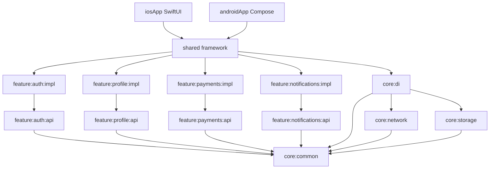

# mvp-modular

Prototype structurel d'un MVP mobile. Android (Jetpack Compose) et iOS (SwiftUI)
partagent le domaine, les cas d'utilisation et les ViewModels Kotlin. L'UI reste
native. Les modules sont liés à la compilation : rien n'est chargé au runtime.

Le compte de démo est `demo@mvp.dev` / `password123`.

## Architecture



Les décisions détaillées et les ADR sont dans [`docs/architecture.md`](docs/architecture.md).
Le périmètre produit est dans [`docs/prd.md`](docs/prd.md).

| Module | Rôle |
| --- | --- |
| `:feature:<nom>:api` | Contrat public : modèles, interfaces, cas d'utilisation |
| `:feature:<nom>:impl` | Repository, ViewModel, module Koin, `actual` plateforme |
| `:core:common` | `Outcome<T, E>`, `DomainError`, logger, feature flags |
| `:core:network` | Ktor et `BffClient` |
| `:core:storage` | `KeyValueStore` en mémoire. Le schéma SQLDelight n'est pas compilé |
| `:core:di` | Agrégat Koin du core |
| `:shared` | Umbrella. Un framework iOS statique `Shared` |
| `:androidApp` | Compose. Dépend uniquement de `:shared` |
| `:iosApp` | SwiftUI. Enveloppe le ViewModel partagé |
| `:architecture-test` | Konsist, frontières de packages |

## Règles de dépendance

Une feature ne dépend que de l'`api` des autres features et de `:core`. Jamais
de l'`impl` d'une autre feature.

| Module | Peut dépendre de |
| --- | --- |
| `:feature:*:api` | `:core:common`, les autres `:feature:*:api` |
| `:feature:*:impl` | sa propre api, les autres api, `:core:*` |
| `:core:common` | bibliothèques seulement |
| `:core:network`, `:core:storage` | `:core:common` |
| `:core:di` | les autres `:core:*` |
| `:shared` | les impl des features et `:core:di` |
| `:androidApp` | `:shared` uniquement |

Deux garde-fous :

- `./gradlew checkModuleBoundaries` parcourt les dépendances Gradle et les `import`.
- `:architecture-test` relit les imports avec Konsist.

Le plugin dependency-analysis n'est pas utilisé : la règle api/impl est plus
précise qu'un diagnostic de dépendances inutilisées.

Les projets imbriqués s'appellent tous `api` ou `impl`. Gradle identifie une
capability par `group:name`. Le `group` de chaque projet est donc
`com.mvpmodular.` suivi du chemin (`com.mvpmodular.feature.auth.impl`). Le
laisser à `com.mvpmodular` fait disparaître toutes les features sauf une du
classpath.

Un feature flag à `false` fait échouer le cas d'utilisation
(`DomainError.Unknown`). Le code reste dans le binaire. `Payments` et
`PushNotifications` sont off. `ProfileEdit` est on. Les paiements (Play Billing
/ StoreKit 2) et le push (FCM / APNs) sont des interfaces avec des stubs.

Les apps parlent à un BFF via `BffClient` (`https://bff.mvpmodular.local`).
Aucun serveur n'est livré. Le login utilise encore un repository en mémoire
(story 1.6).

## Toolchain

Kotlin 2.4.21, AGP 9.3.1, Gradle 9.7.0, JDK 21, Koin 4.2.2, Ktor 3.6.0,
coroutines 1.11.0, Compose BOM 2026.06.01, SKIE 0.10.15, detekt 2.0.0-alpha.6,
ktlint 14.2.0, Konsist 0.18.1. `compileSdk` 37, `minSdk` 26, `targetSdk` 36.
Le catalogue est `gradle/libs.versions.toml`. Les conventions sont dans
`build-logic`.

Les cibles Apple ne sont déclarées que sur macOS. SKIE n'est appliqué que là.
`kotlin.native.ignoreDisabledTargets=true` permet à `./gradlew build` de passer
sur Linux.

## Android

Prérequis : JDK 21 et Android SDK `platforms;android-37.0` plus
`build-tools;36.0.0`. `local.properties` peut fixer `sdk.dir`. Il est ignoré
par git.

```bash
./gradlew :androidApp:assembleDebug
./gradlew :androidApp:installDebug
```

Le second nécessite un appareil ou un émulateur. L'écran de connexion est
`LoginRoute` dans `androidApp`. Il collecte le `LoginViewModel` partagé avec
`collectAsStateWithLifecycle`.

## iOS

Ouvrir `iosApp/MvpModular.xcodeproj` sur un Mac, schéma `MvpModular`,
simulateur. La phase Run Script appelle
`./gradlew :shared:embedAndSignAppleFrameworkForXcode`, sauf si
`OVERRIDE_KOTLIN_BUILD_IDE_SUPPORTED=YES`. Le framework statique `Shared` n'est
pas embarqué par une phase Embed. `ENABLE_USER_SCRIPT_SANDBOXING` reste à NO.

`LoginViewModelWrapper` lit `state.value` puis observe le `StateFlow` avec
`for await` (SKIE). Aucune règle métier n'est recopiée en Swift.

Ce dépôt n'a pas été compilé pour iOS ici : la VM est Linux.

SwiftLint, sur macOS :

```bash
swiftlint lint --config .swiftlint.yml iosApp
```

La CI lance ce job sur `macos-latest`.

## Tests et vérifications

```bash
./gradlew build
./gradlew checkModuleBoundaries
./gradlew :feature:auth:api:testAndroidHostTest
./gradlew :feature:auth:impl:testAndroidHostTest
```

`commonTest` est exécuté comme test hôte Android (`withHostTest`, tâche
`testAndroidHostTest`).

## Ajouter une feature

1. Créer `feature/<nom>/api` (`mvp.kmp.feature.api`) et `feature/<nom>/impl`
   (`mvp.kmp.feature.impl`).
2. Les inclure dans `settings.gradle.kts`.
3. Mettre modèles, interface de repository et cas d'utilisation dans l'api.
   Le cas d'utilisation retourne `Outcome`. Les tests vont dans `commonTest`.
4. Mettre le repository `internal`, le ViewModel, l'`UiState` et
   `val <nom>Module` dans l'impl.
5. Ajouter le module à `featureModules()` dans `:shared`, un accesseur sur
   `SharedGraph`, et les `export` dans `mvp.kmp.shared.gradle.kts`.
6. Brancher un écran Compose et un wrapper SwiftUI. Les apps ne dépendent pas
   du module feature directement.
7. Relancer `checkModuleBoundaries` et les tests hôtes.

Le skill Cursor `new-feature-module` détaille les fichiers. `add-use-case`
couvre l'ajout d'un cas d'utilisation dans une feature existante.

## Développement guidé (BMAD)

Le dépôt embarque la [BMAD Method](https://github.com/bmad-code-org/BMAD-METHOD)
(Breakthrough Method for Agile AI-Driven Development), ligne stable **6.12**,
installée avec :

```bash
npx bmad-method install --directory . --modules bmm --tools cursor \
  --communication-language French --document-output-language French \
  --output-folder _bmad-output --yes
```

`uv` est requis pour les scripts Python des skills (`uv run`).

| Élément | Emplacement |
| --- | --- |
| Skills officiels (analyst, PM, architecte Winston, dev, workflows) | `.agents/skills/` |
| Personnalisation de l'architecte pour ce graphe de modules | `_bmad/custom/bmad-agent-architect.toml` |
| Rôles projet, demandables dans Cursor | `.cursor/rules/bmad-*.mdc` |
| Règles de code (KMP, Compose, SwiftUI, tests) | `.cursor/rules/*.mdc` |
| Recettes (nouveau module, cas d'utilisation, revue) | `.cursor/skills/` |
| Carte du dépôt pour les agents | `AGENTS.md` |
| Sortie générée par un workflow | `_bmad-output/` (ignoré par git) |

Les rôles officiels installés sont l'analyste (Mary), le PM (John),
l'architecte (Winston), le dev (Amelia) et l'UX (Sally). Le scrum master et
la QA ne sont pas des agents séparés dans cette version : la rédaction
d'histoires passe par `bmad-create-epics-and-stories`, la revue par
`bmad-code-review`. Les règles `bmad-sm` et `bmad-qa` portent ces deux rôles
pour ce dépôt, avec le format d'histoire déjà utilisé dans `docs/stories/`.
Les shims dépréciés (`bmad-create-story`, `bmad-dev-story`) ne sont pas
installés.

Enchaînement attendu :

1. **PRD** — analyste et PM mettent à jour `docs/prd.md`.
2. **Architecture** — Winston s'appuie sur `docs/architecture.md`. Une décision
   nouvelle devient un ADR. Pas de chargement dynamique, pas de dépendance
   impl → impl.
3. **Histoire** — un epic est découpé dans `docs/stories/` (statut, histoire,
   critères, tâches, notes de dev, fichiers, changelog). L'epic 01 couvre le
   login. La story 1.6 (repository BFF) est la prochaine.
4. **Dev** — une histoire à la fois, skills `new-feature-module` ou
   `add-use-case`. Tests hôtes et `checkModuleBoundaries`.
5. **QA** — skill `review`. Dire explicitement ce qui n'a pas été exécuté
   (iOS, SKIE, émulateur).

Pour invoquer un rôle dans Cursor : demander l'analyste, le PM, Winston
(architecte), la rédaction d'une histoire, le dev, ou une revue QA. Les règles
de code s'appliquent seules selon les fichiers touchés.

## Ce qui a été vérifié

Vérifié sur Linux : `./gradlew build checkModuleBoundaries` (assemble debug et
release, detekt, ktlint) puis les tests hôtes relancés à part. 22 tests
passent : `Outcome`, feature flags, store mémoire, login (cas d'utilisation,
faux repository, ViewModel), profil, paiements, push, et les deux tests
Konsist de frontières.

Pas vérifié ici, faute de macOS et d'émulateur :

- compilation Kotlin/Native, SKIE, et le projet Xcode ;
- SwiftLint en local (le job CI existe) ;
- installation de l'APK et parcours de l'écran sur un appareil.

## Suite

- Story 1.6 : `AuthRepository` qui appelle `BffClient`.
- Écrans profil, paiements, notifications.
- Brancher SQLDelight derrière `KeyValueStore` (`core/storage/schema/AppDatabase.sq`).
- Remplacer les stubs Play Billing, StoreKit, FCM et APNs.
- Un job CI macOS qui compile `:shared` pour le simulateur.
