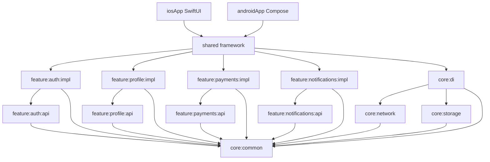

# Architecture

Prototype structurel d'un MVP mobile modulaire. Les applications iOS et Android
partagent le domaine, les cas d'utilisation et les ViewModels. L'UI reste native.

## Diagramme des modules

Les flèches sont des dépendances Gradle de compilation. Rien n'est chargé
dynamiquement au runtime.

Les modules `api` et `impl` portent tous le même nom Gradle (`api` ou `impl`).
La capability par défaut est `group:name`. Le `group` de chaque projet est donc
`com.mvpmodular.` plus le chemin (`com.mvpmodular.feature.auth.impl`), sinon
Gradle ne garde qu'une seule impl sur le classpath. Le nom d'archive et le
module Kotlin suivent le chemin (`feature-auth-impl`).

## Règles de dépendance

| Module | Peut dépendre de | Ne peut pas dépendre de |
| --- | --- | --- |
| `:feature:*:api` | `:core:common`, l'api d'une autre feature | tout `:feature:*:impl`, network, storage, di, shared, androidApp |
| `:feature:*:impl` | sa propre api, les api des autres features, `:core:*` | un autre `:feature:*:impl`, shared, androidApp |
| `:core:common` | bibliothèques uniquement | tout module du projet |
| `:core:network`, `:core:storage` | `:core:common` | features, di, apps |
| `:core:di` | les autres modules `:core:*` | features, apps |
| `:shared` | les impl des features et `:core:di` | androidApp |
| `:androidApp` | `:shared` | un module feature ou core en direct |

Le contrat public d'une feature est l'api : modèles, interfaces de repository,
cas d'utilisation. L'implémentation (repository concret, passerelle plateforme)
est `internal`. Restent publics dans l'impl : le ViewModel, l'`UiState` et le
module Koin, parce que les apps et `:shared` doivent les voir.

`:shared` exporte le tout comme un framework iOS statique `Shared`. SKIE est
appliqué seulement sur macOS, au moment de produire ce framework.

## Couches

Chaque feature a trois couches, dans les modules api et impl :

- **data** — réseau (via `:core:network`) et cache (via `:core:storage`).
  Dans ce MVP, le login utilise un repository en mémoire.
- **domain** — cas d'utilisation et modèles. Les erreurs métier passent par
  `Outcome<T, E>` et `DomainError`, pas par des exceptions.
- **presentation** — ViewModels KMP qui exposent un `StateFlow`. Android le
  collecte avec `collectAsStateWithLifecycle`. iOS passe par un wrapper Swift
  `async/await` grâce à SKIE.

## Composition

Koin est démarré une seule fois dans `initAppKoin` (`:shared`). Chaque feature
publie son `module { }` et `:core:di` agrège logger, feature flags, client BFF
et cache. Android ajoute `androidContext` dans le lambda. Il n'y a pas de
service loader ni de chargement de module à la volée : un flag désactivé
court-circuite un cas d'utilisation déjà compilé.

## ADR

### ADR-001 — Découpage api / impl

- Statut : accepté
- Contexte : une feature qui mélange contrat et implémentation fuit ses détails
  (Ktor, SQLDelight, Play Billing) vers les autres features et vers les apps.
- Décision : `:feature:<nom>:api` et `:feature:<nom>:impl`. L'impl dépend de
  son api. Aucune impl ne dépend d'une autre impl.
- Conséquences : le contrat est testable sans la plateforme. Ajouter une
  feature, c'est deux modules et une ligne dans `:shared`.

### ADR-002 — Modules core

- Statut : accepté
- Contexte : le réseau, le cache, les erreurs et l'injection ne sont pas des
  features produit.
- Décision : `:core:common` (Outcome, DomainError, logger, feature flags),
  `:core:network` (client Ktor et `BffClient`), `:core:storage` (cache),
  `:core:di` (agrégat Koin).
- Conséquences : une feature api ne voit que common. Le client HTTP n'est pas
  un détail du domaine auth.

### ADR-003 — Umbrella `shared` et SKIE

- Statut : accepté
- Contexte : iOS ne consomme pas une quinzaine de klibs.
- Décision : `:shared` dépend en `api` de toutes les impl et de `:core:di`,
  et exporte un framework statique `Shared`. SKIE (`0.10.15`) traduit Flow et
  suspend en Swift. Les cibles Apple ne sont déclarées que sur macOS.
- Conséquences : `./gradlew build` passe sur Linux. Le binaire iOS se vérifie
  sur un Mac. SKIE est validé par Touchlab pour Kotlin 2.4.20 ; le projet est
  sur le correctif 2.4.21.

### ADR-004 — Koin, lien à la compilation

- Statut : accepté
- Contexte : un conteneur qui chargerait des modules au runtime casserait le
  graphe et le tree-shaking.
- Décision : Koin 4.2, modules déclarés en Kotlin, enregistrés dans
  `initAppKoin`. Pas de `ServiceLoader`, pas de réflexion pour découvrir les
  features.
- Conséquences : oubli d'un module = erreur au démarrage, visible tout de suite.

### ADR-005 — `Outcome<T, E>`

- Statut : accepté
- Contexte : les exceptions mélangent annulation, bugs et erreurs métier.
- Décision : `Outcome.Success` / `Outcome.Failure` et `DomainError` scellé
  (validation, unauthorized, not found, network, unknown). `CancellationException`
  est relancée. Le ViewModel projette `error.message` vers l'UI.
- Conséquences : les apps n'ont pas à interpréter le type d'erreur pour le
  login. Les cas d'utilisation restent des fonctions totales.

### ADR-006 — Feature flags sans chargement dynamique

- Statut : accepté
- Contexte : payments et push ne sont pas prêts, mais leurs modules doivent
  déjà être dans le binaire pour figer l'architecture.
- Décision : `FeatureFlags` dans `:core:common`, implémentation
  `StaticFeatureFlags`. Un flag à `false` fait échouer le cas d'utilisation
  avec `DomainError.Unknown`. Le code est quand même lié.
- Conséquences : désactiver un flag ne réduit pas la taille de l'app. C'est
  voulu pour ce MVP.

### ADR-007 — BFF

- Statut : accepté
- Contexte : les apps ne doivent pas parler à plusieurs backends (auth, billing,
  push provider).
- Décision : `:core:network` expose `BffClient`. Les data sources futures
  passent par lui. L'URL par défaut est `https://bff.mvpmodular.local`. Il n'y
  a pas de serveur dans ce dépôt : le login est un faux repository.
- Conséquences : remplacer le faux login, c'est une impl de `AuthRepository`
  qui appelle `BffClient`, sans toucher au ViewModel.

### ADR-008 — Paiements et push derrière des interfaces

- Statut : accepté
- Contexte : StoreKit 2, Play Billing, APNs et FCM sont des SDK plateforme.
- Décision : `PaymentGateway` et `PushRegistrar` dans l'api. `expect/actual`
  internes dans l'impl, stubs qui retournent `Outcome.Failure`. Les flags
  `Payments` et `PushNotifications` sont off par défaut.
- Conséquences : le domaine se teste avec un faux gateway. Brancher le SDK
  réel ne change pas le cas d'utilisation.

### ADR-009 — Cache mémoire à la place de SQLDelight

- Statut : accepté, temporaire
- Contexte : SQLDelight 2.4 et le plugin Android KMP ajoutent des drivers
  natifs pour un écran qui ne persiste rien.
- Décision : `KeyValueStore` + `InMemoryKeyValueStore`. Le schéma prévu est
  dans `core/storage/schema/AppDatabase.sq`, non compilé.
- Conséquences : la session meurt avec le process. La prochaine étape est de
  brancher SQLDelight derrière la même interface.

## Toolchain

| Outil | Version |
| --- | --- |
| Kotlin | 2.4.21 |
| AGP | 9.3.1 |
| Gradle | 9.7.0 |
| JDK | 21 |
| Koin | 4.2.2 |
| Ktor | 3.6.0 |
| Coroutines | 1.11.0 |
| Lifecycle KMP / AndroidX | 2.11.0 |
| Compose BOM | 2026.06.01 |
| SKIE | 0.10.15 |
| compileSdk / minSdk / targetSdk | 37 / 26 / 36 |
| detekt | 2.0.0-alpha.6 |
| ktlint (plugin) | 14.2.0 |
| Konsist | 0.18.1 |

AGP 9.3.1 est le dernier palier entièrement couvert par Kotlin 2.4.21
(AGP max 9.3.1, Gradle max 9.7.0). `compileSdk` 37, parce qu'OkHttp 5.5
(tiré par Ktor) l'exige. `targetSdk` reste 36.
